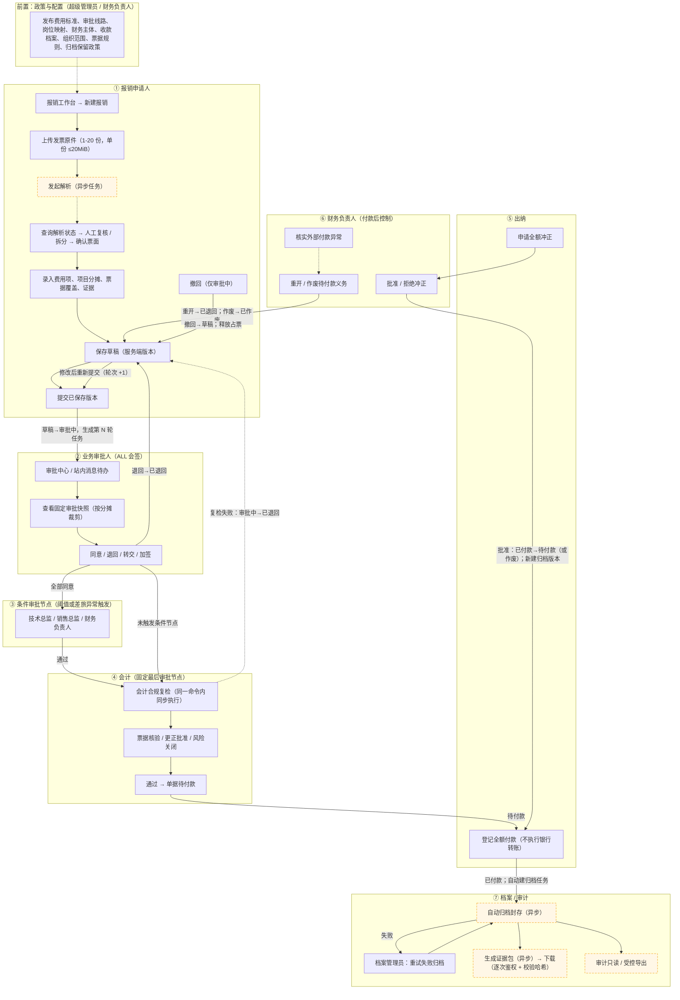
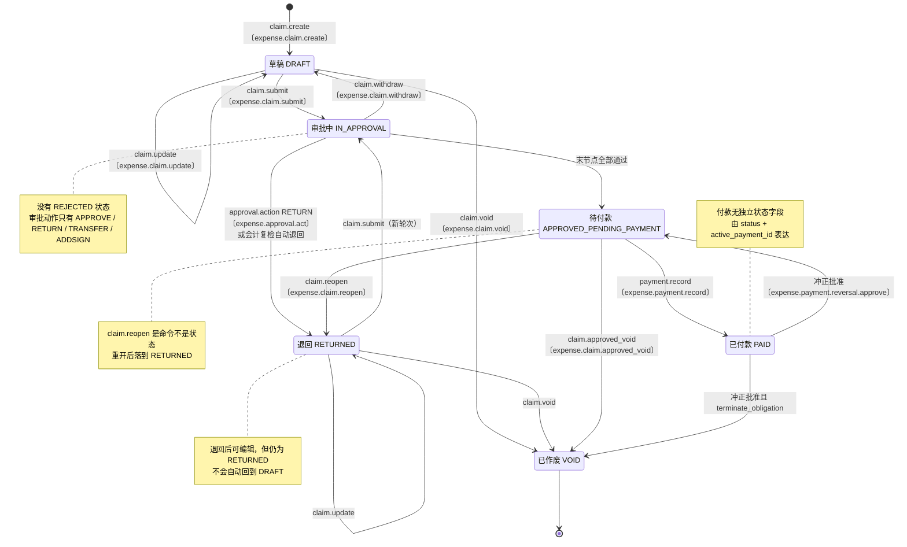
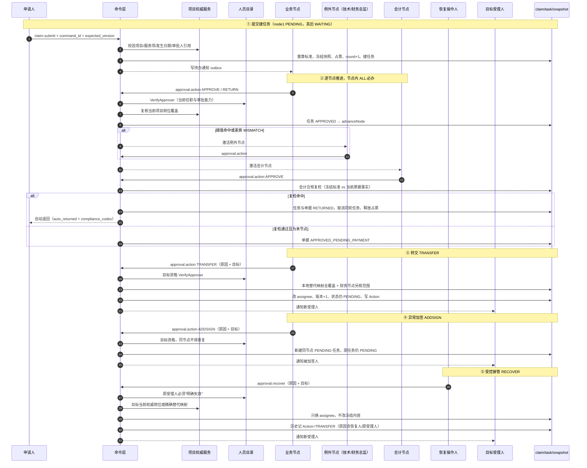
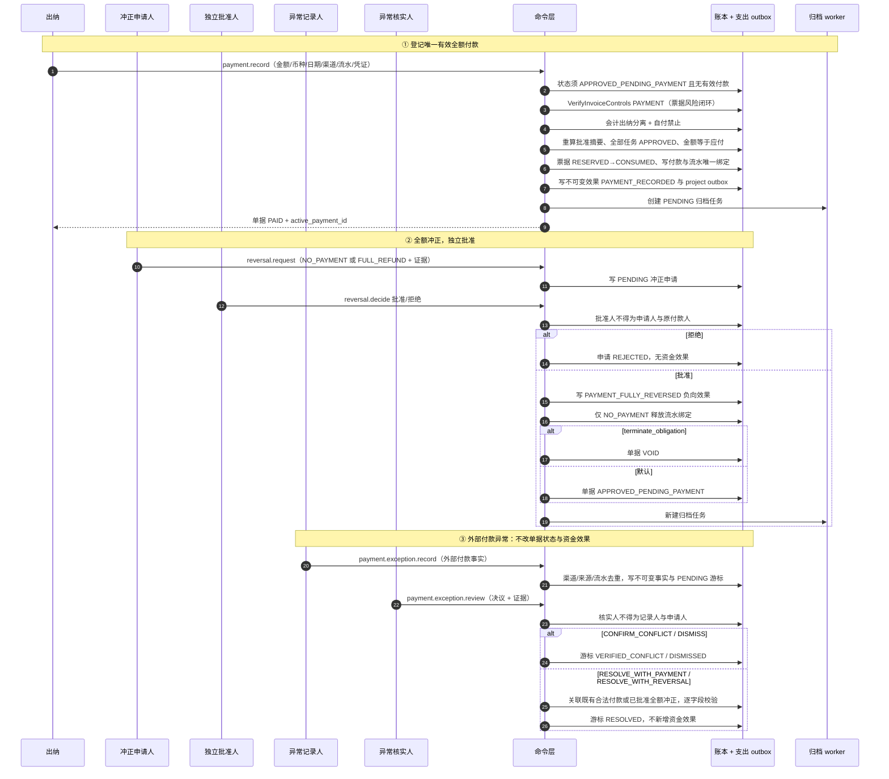
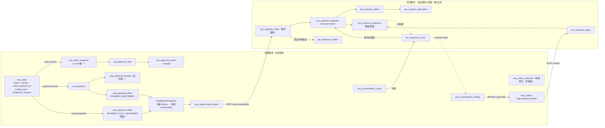
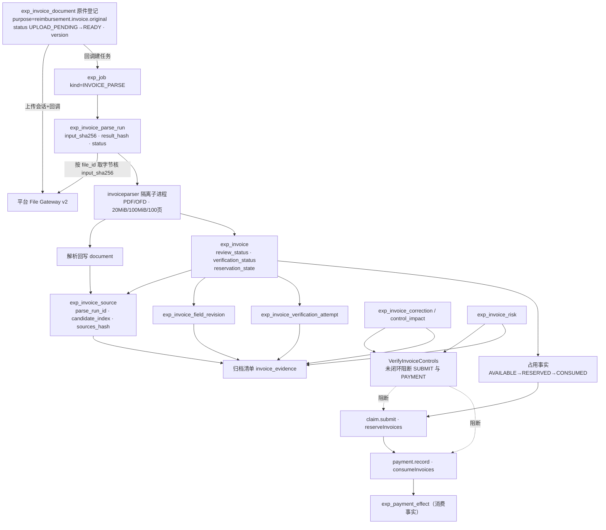
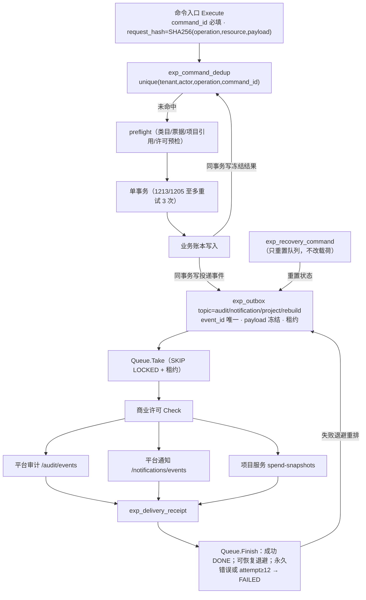
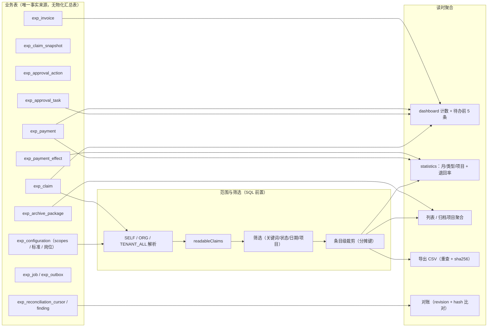
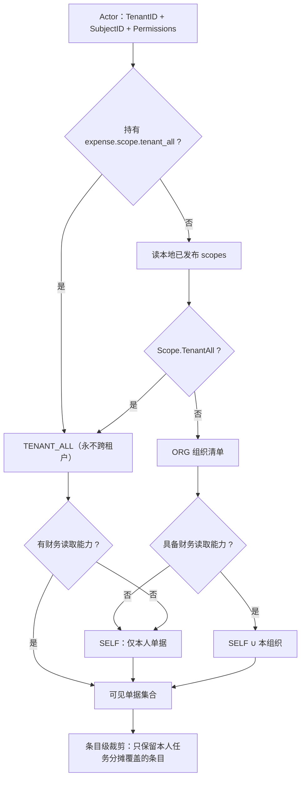

# 报销管理 · 业务流程图（含数据流、证据链与报表口径）

> **依据**：`reimbursement/` 源码（状态机、命令层、审批/付款/归档实现）、`migrations/000001-000010`、`api/openapi.yaml`、`authz/permission-manifest.yaml`（catalog v4 / 9 角色 / 32 权限）、前端 `ReimbursementView.vue` 与组件。
> **配套文档**：[报销系统角色与权限说明.md](./报销系统角色与权限说明.md)、`流程图/` 下旧版业务流程图与 ER 图（本文第 8 节列出与旧图的 11 处差异）。
> **性质**：只读代码核对产出，**未运行服务、未连数据库、Mermaid 未在目标渲染器验证**；当前为源码开发阶段，不代表真实平台验收通过。
> **图例**：实线＝同步步骤；点线/虚线＝异步任务或派生关系；数据图里 蓝＝可变状态、橙＝不可变事实/快照、绿＝派生投影、紫＝队列/租约、灰＝外部系统。

---

## 0. 先纠正三个容易画错的顺序

1. **会计是固定最后一个审批节点**，不是"独立于审批链的财务环节"。审批计划顺序是：业务节点（项目经理/销售总监，ALL 会签）→〔条件〕例外节点（技术总监/财务总监）→〔条件〕历史尾款财务总监 → **会计（固定追加）**。
2. **财务负责人在流程里出现两次**：①金额/比例阈值命中或差旅异常时的**条件审批节点**；②**付款后**的冲正批准、重开、作废已批准义务。不是一条线上的相邻两步。
3. **没有"驳回"和"已撤回"**：代码只有 `RETURN`（退回，单据 `RETURNED`）与 `withdraw`（撤回后回到 `DRAFT`）。`REJECTED` 只用于借阅申请、冲正申请、票据更正案件，不是单据状态。

---

## 1. 端到端主流程（按角色）

**关键节点说明**

| 环节 | 实际行为 | 异步/同步 |
|---|---|---|
| 票据解析 | 上传成功后需**手动发起解析**，再**手动查询状态**；图片（拍照票）不解析，只能人工确认 | 异步 |
| 提交 | 一个事务内冻结标准/审批线路/票据/收款快照、占票、生成任务、分配单号；失败整体回滚 | 同步 |
| 审批推进 | 同节点 ALL 会签，全部通过才激活下一节点；末节点通过→待付款 | 同步 |
| 会计复检 | 不是独立节点：会计点"同意"时先跑合规复检，命中问题**原子改为退回**并通知申请人 | 同步 |
| 付款 | 只登记线下付款事实（金额必须等于应付），系统不转账；自动创建归档任务 | 同步 + 异步归档 |
| 归档/证据包/导出 | 全部异步任务，需手动查询状态；下载逐次重新鉴权并复核 SHA256 | 异步 |

---

## 2. 单据状态机

**状态与迁移（含守卫）**

| 转换 | 命令 | 权限 | 关键守卫 / 副作用 |
|---|---|---|---|
| → `DRAFT` | `claim.create` | `expense.claim.create` | 仅本人；只建草稿，不分配单号 |
| `DRAFT/RETURNED → 自身` | `claim.update` | `expense.claim.update` | 仅本人、仅这两种状态、版本匹配 |
| → `IN_APPROVAL` | `claim.submit` | `expense.claim.submit` | 票据控制闭环；冻结快照；占票；轮次 +1；首次分配单号 `BX-YYYY-NNNNNN` |
| `IN_APPROVAL → DRAFT` | `claim.withdraw` | `expense.claim.withdraw` | 取消本轮 PENDING/WAITING 任务；释放 `RESERVED` 票据；轮次不回退 |
| `DRAFT/RETURNED → VOID` | `claim.void` | `expense.claim.void` | 仅本人；审批中不能直接作废，须先撤回 |
| `IN_APPROVAL → RETURNED` | `approval.action` RETURN | `expense.approval.act` | 仅当前受理人且非申请人；原因必填；取消同轮任务；**手动退回不释放占票** |
| `IN_APPROVAL → RETURNED`（自动） | 会计 APPROVE 触发复检 | `expense.approval.act` | 命中合规问题 → 改写为 RETURN，返回 `auto_returned=true`；取消任务并**释放占票** |
| → `APPROVED_PENDING_PAYMENT` | `approval.action` APPROVE | `expense.approval.act` | 节点内全部通过才推进；末节点完成置待付款 |
| `APPROVED_PENDING_PAYMENT → RETURNED` | `claim.reopen` | `expense.claim.reopen` | 非申请人、无有效付款、原因必填；不改旧快照/审批/付款 |
| `APPROVED_PENDING_PAYMENT → VOID` | `claim.approved_void` | `expense.claim.approved_void` | 非申请人、无有效付款；只释放 `RESERVED` 票据 |
| → `PAID` | `payment.record` | `expense.payment.record` | 会计≠出纳、申请人≠付款人；金额=应付；全部任务 APPROVED；票据 `RESERVED→CONSUMED` |
| `PAID → APPROVED_PENDING_PAYMENT` | `reversal.decide` 批准 | `expense.payment.reversal.approve` | 批准人独立于申请人与原付款人；全额负向效果；不回退审批轮次 |
| `PAID → VOID` | 同上 + `terminate_obligation` | 同上 | 同上 |
| `IN_APPROVAL → RETURNED`（票据更正） | `invoice.correction.decide` 批准 | `expense.invoice.correct` + `expense.finance.review` | 仅未付单改票面并退回；已付单不改状态，只建财务复核风险 |

> `PAID` 不是终态（可冲正），`VOID` 才是终态。`exp_claim.status` 在数据库层是 `VARCHAR(40)` 无 CHECK 约束，状态由代码写入。

---

## 3. 审批节点时序（会签、加签、转交、接管）

**节点生成规则**

| 节点 | 受理人来源 | 触发条件 |
|---|---|---|
| 业务首审 | 技术线＝项目经理权威引用；销售线＝项目销售总监 | 必有 |
| 例外节点 | `route_rules.extra_role`（技术总监/财务总监） | 逐项金额或比例阈值命中，或差旅 `MISMATCH` 经确认 |
| 历史尾款节点 | 财务负责人 | 历史尾款场景 |
| 会计节点 | 本地已发布 `assignments` 的 `accounting_role` | **必有，且在最后** |

> 注意：未触发时**根本不生成该节点任务**，不是"生成后跳过"。转交/接管只改受理人，不改任务状态与冻结内容；加签在同一节点新增必办任务，全部会签通过才推进。

---

## 4. 付款、冲正与外部付款异常

> 冲正后票据保持 `CONSUMED`；若要重新提交，需要"历史付款全部已获独立批准的全额冲正"的完整链。外部付款异常只是追加事实，不改变单据状态与项目净额。

---

## 5. 数据流转与证据链

### 5.1 单据 → 支出快照 → 项目侧投影（跨系统）

**关键语义**

1. 单据可变的只有 `exp_claim`（版本 CAS）与任务状态；提交即冻结 `exp_claim_snapshot`（round 唯一），批准内容哈希可从快照独立复算。
2. 支出快照**不是增量**：每次付款/全额冲正都读全量不可变 effect 历史，重算净额后生成 `snapshot_hash`。
3. 项目侧消费顺序：锁 cursor → inbox 幂等 → 落 snapshot → 追加 effect/allocation → **整单删除重建投影** → 更新 cursor → 写回执（`APPLIED/DUPLICATE/SUPERSEDED`）。
4. rebuild 只能基于 cursor 指向的已验摘要快照，不改 effect 历史；`HISTORY_CONFLICT` 禁止自动修复。

### 5.2 发票原件 → 解析运行 → 票据 → 占用/消费

**不可变事实链（逐跳可核）**

`原件字节（File Gateway）` → `input_sha256` → `parse_run.result_hash` → `invoice_source.sources_hash` → `票据 version + field_revision` → `verification_attempt` → `reservation（占用到某单据）` → `payment_effect.approved_content_hash` → `归档 manifest.files[].sha256`。

### 5.3 命令幂等与 outbox → 平台审计/通知

**关键语义**

- 幂等域 `(tenant, actor, operation, command_id)`；同 hash 回放冻结结果，不同 hash → 409 `COMMAND_PAYLOAD_CONFLICT`；回放仍按**当前**权限重检可见性。
- 业务事实 + 命令结果 + 审计 outbox 在**同一事务**；审计入队失败则整命令回滚。
- 投递只做 DTO 转换与稳定重投，**绝不重做财务命令**；回执 `ACCEPTED` 不等于送达。
- 人工恢复走 `exp_recovery_command`，自身也是 command_id 幂等账本。

### 5.4 归档封存 → 证据包 → 下载

```mermaid
flowchart LR
  T["触发：payment.record / reversal.decide / 票据控制变更"]
  AP["exp_archive_package<br/>package_version 单调 +1<br/>PENDING/SEALED/FAILED · manifest_hash"]
  J1["exp_job kind=ARCHIVE（payload 冻结）"]
  MF["封存计算 manifest<br/>批准快照+付款快照+票据+解析运行+来源+更正风险+文件 sha256"]
  HSC["manifest_hash = SHA256(manifest)"]
  SEAL["UPDATE ... SET SEALED WHERE status<>SEALED + 审计"]
  CMD["命令 archive.package.create<br/>要求 SEALED + 当前整单授权"]
  J2["exp_job kind=ARCHIVE_PACKAGE"]
  ZIP["ZIP 构建：逐件重算 SHA256 比对<br/>≤100 件 · ≤100MiB · ≤20MiB 包"]
  DL["exp_archive_download<br/>sha256=SHA256(zip) + 审计"]
  GET["GET /archive-packages/{id}/download<br/>重新鉴权 + 重算 SHA256"]
  OUT["下载字节流"]
  RET["保留期清理（默认 72h）→ 状态 EXPIRED"]
  FG["平台 File Gateway v2"]
  T --> AP
  T --> J1 --> MF
  FG -->|"逐件读原件并现算 sha256"| MF
  MF --> HSC --> SEAL --> AP
  AP --> CMD --> J2 --> ZIP --> DL --> GET --> OUT
  MF -.->|"封存清单"| ZIP
  DL -.-> RET
```

**四个哈希校验点**：① 封存时逐件读原件现算 sha256 写入清单；② 建包时要求 `manifest_hash` 与请求冻结值一致，ZIP 内逐件重算比对；③ 落库 `exp_archive_download.sha256 = SHA256(zip)`；④ 下载时重新鉴权并重算比对，不符 409 `ARCHIVE_PACKAGE_HASH_MISMATCH`，每次下载写审计。

### 5.5 可变 / 不可变总表

| 表 | 判定 |
|---|---|
| `exp_claim` | 可变（版本 CAS + `active_payment_id` 唯一） |
| `exp_claim_snapshot` | **不可变**（只 INSERT，round 唯一） |
| `exp_approval_task` / `exp_claim_reference` | 可变 |
| `exp_approval_action(+detail)` | **只追加**（转交每跳留证据） |
| `exp_payment` / `_binding` / `_effect` / `_reversal` | **不可变**（唯一业务键防重） |
| `exp_command_dedup` | **不可变**（结果冻结） |
| `exp_outbox` / `exp_job` | 载荷冻结，队列状态可变 |
| `exp_delivery_receipt` | 回执可覆盖同一 outbox |
| `exp_invoice` | 内容留修订、状态可变 |
| `exp_invoice_source` / `_parse_run` / `_field_revision` / `_verification_attempt` | **只追加** |
| `exp_invoice_correction` / `_control_impact` / `_risk` | 案件状态可变，内容留痕 |
| `exp_archive_package` | `SEALED` 后不可变 |
| `exp_archive_download` | **只追加**（可被保留期清理） |
| `exp_reconciliation_cursor` / `_finding` | 可变当前态 |
| `exp_recovery_command` | **不可变** |
| `pm_expense_inbox/snapshot/effect/allocation` | **不可变** |
| `pm_expense_projection` | 派生可变（整单替换） |
| `pm_expense_cursor` | 可变 |
| `pm_expense_repair/conflict` | **只追加** |

### 5.6 关键数据不变量（摘要）

| 组 | 不变量 |
|---|---|
| 金额与覆盖 | 每项 `Σ分摊=申请金额`；`Σ票据使用=申请金额` 或有 `no_invoice_reason`；单据应付=Σitems 且每项 >0；单票本单使用额 ≤ 票面且票须本人、已确认、非 MISMATCH；上限 100 项/1000 分摊/200 票/200 证据 |
| 付款与冲正 | 最多一个有效付款；金额/币种/收款资料=批准快照；会计≠出纳、申请人≠付款人、冲正批准人独立；冲正必须全额且唯一；流水三要素唯一，仅"实际未付+独立批准+真实反向"可释放 |
| 支出快照 | schema v1、complete、CNY、数量上限、≤2MiB；每 effect `Σ分摊=金额`；快照内 `(payment_record_id,kind)` 唯一；`contributions=Σeffects 净额` 且键集一致；`snapshot_hash` 双侧同算同验 |
| 项目侧 | `(tenant,env,event_id)` 幂等；历史 effect 不可缺失/篡改/跨单复用；投影只整单替换；rebuild 只能基于已验快照；新付款前必须预演"付款+全额冲正"均可发布（80% 容量告警） |
| 命令与投递 | 同 command_id 只允许同 hash；业务+结果+审计同事务；outbox 租约 CAS 防迟到 worker；对账仅两类可自动修复，同版本异 hash 禁止覆盖 |
| 归档与下载 | package_version 单调；SEALED 后清单不可变；`manifest_hash=SHA256(manifest)`；包内逐件 sha256 一致；下载重算比对不符 409；建包/下载都要求**当前**完整授权 |

---

## 6. 报表与对账口径

### 6.1 数据来源图

### 6.2 数据范围判定

> **注意**：平台侧的 `data_scopes`（SELF/ORG/PROJECT）不参与报销应用层范围计算；报销只认本地 `scopes` 配置 + `tenant_all`。仅在平台配了范围、未在报销发布 `scopes` 时，报表仍是 SELF。

### 6.3 指标口径（摘要）

| 报表 | 指标 | 口径 |
|---|---|---|
| 驾驶舱 `/dashboard` | `my_claims` | 本人单据数（**不限状态**，含草稿/作废） |
| | `pending_approvals` / `pending_tasks` | 本人受理的当前轮 PENDING 任务（需 `approval.act`，否则恒 0） |
| | `pending_payments` | 可见范围内待付款且非本人申请（**受范围影响**） |
| | `invoice_review_required` | 本人发票未确认数 |
| | `my_paid_this_month` | 本人本月**已付款单据数（不是金额）** |
| 看板 `/statistics` | 月/类型/项目金额 | 只计 `PAID`；金额取付款净额；可见分摊累加；账本不一致 409 |
| | 计数类 | **含全部状态**（草稿/退回/审批中/作废） |
| | 退回率 | 分子=有 RETURN 动作的可见单；分母=有提交快照的可见单；分母为 0 返回 null |
| | 超标准/异常计数 | 可见条目任一命中即计 1 单（隐藏条目不参与） |
| 列表 `/claims` | total | 仅计数，**无金额合计** |
| 导出 `/exports` | CSV | 5 列（单号/标题/状态/应付分/币种），≤100 单，无合计行；**只按 project_id 过滤，列表的其它筛选不进导出** |
| 对账 | finding | 比对 `projection_revision + snapshot_hash`；仅 REMOTE_MISSING/REMOTE_BEHIND/PROJECTION_CORRUPT 可修复，HISTORY_CONFLICT 禁止覆盖 |

### 6.4 实现状态

**已实现**：驾驶舱与看板聚合、账本一致性硬校验、列表范围与条目裁剪、导出全链路（幂等/限额/二次授权/摘要校验）、对账游标与受控重建、归档项目聚合、队列 2 个 gauge、归档下载 TTL 清理。

**缺口（按业务影响）**：① 报表不告知"部分可见"，局部审批人看到的金额被静默截断；② 无组织维度报表、无审批时效报表；③ 列表/导出均无金额合计；④ 指标埋点基本缺失（仅 2 个队列 gauge，无解析/导出/归档/对账耗时与成功率）；⑤ 无 TTL 指标；⑥ `/metrics` 仅在 worker 且受许可门禁；⑦ 对账无汇总/趋势；⑧ 平台 `data_scopes` 不参与报表范围；⑨ `exception_only` 对单据/统计被静默忽略；⑩ 导出不受列表筛选影响；⑪ 统计报表无法导出。

---

## 7. 异步任务与状态可见性

### 7.1 异步任务矩阵

| 环节 | 载体 | 触发 | 用户如何看到 | 自动刷新 | 失败后 |
|---|---|---|---|---|---|
| 上传确认 | 文件网关文档 `READY` | 申请人 | 上传批次状态 | 否 | 申请人重试 |
| 票据解析 | `INVOICE_PARSE` job | 申请人 | 手动查询解析状态 | 否 | 重新发起；异常发票池 |
| 待办通知 | outbox → 平台通知 | 系统 | 站内消息 | 否 | 管理员重投失败投递 |
| 项目支出同步 | outbox `project` | 系统 | 详情页同步状态 | 否 | 管理员重投快照 |
| 归档封存 | `ARCHIVE` job | 付款/冲正后自动 | 归档中心手动查询 | 否 | 档案管理员重试（生成后继版本） |
| 证据包 | `ARCHIVE_PACKAGE` job | 档案/审计 | 手动查询状态 | 否 | 重新生成 |
| 受控导出 | `EXPORT` job | 档案/审计 | 手动查询状态 | 否 | 重新创建 |
| 审计事件 | outbox `audit` | 系统 | 本模块无页面 | — | 管理员重投 |

### 7.2 用户"看不到状态"的七个位置

1. **审批中**只能看到"审批中 + 当前节点英文码"，无进度推送、无实时刷新。
2. **人工退回不发通知**：只有会计"自动退回"会通知申请人；业务审批人手工退回没有任何通知。
3. **付款完成不通知申请人**，且申请人没有 `payment.read`，看不到付款流水与凭证。
4. **归档进度不可见**：付款页不展示归档状态，失败也无通知，可能长期停留 `FAILED`。
5. **英文枚举外露**：解析任务（`RUNNING/PARSED/PARTIAL`）、文档状态、付款记录（`RECORDED`）、任务（`WAITING/TRANSFERRED/CANCELLED`）原样显示。
6. **通知依赖平台**：outbox 投递失败只进运维页，审批人可能收不到待办。
7. **前端无轮询**：归档/导出/建包都要手动点"查询状态"。

### 7.3 状态文案对照

| 对象 | 编码 → 前端文案 |
|---|---|
| 单据 | `DRAFT` 草稿 · `IN_APPROVAL` 审批中 · `RETURNED` 已退回 · `APPROVED_PENDING_PAYMENT` 待付款 · `PAID` 已付款 · `VOID` 已作废（`WITHDRAWN` 仅字典存在，后端不产生） |
| 审批任务 | `PENDING` 待处理 · `APPROVED` 已同意 · `RETURNED` 已退回 · `WAITING/TRANSFERRED/CANCELLED` 无中文映射 |
| 归档 | `PENDING` 待处理 · `SEALED` 已封存 · `FAILED` 处理失败 |
| 证据包 | `PENDING` 排队中 · `PROCESSING` 生成中 · `DONE` 已完成 · `FAILED` 生成失败 · `EXPIRED` 已过期 |
| 发票复核 | `PENDING` 待处理 · `CONFIRMED` 已人工复核 |
| 发票查验 | `NOT_CHECKED` 未查验 · `MANUAL_REVIEWED` 已人工核验 · `MISMATCH` 内容不一致 · `VERIFIED` 无映射 |
| 发票占用 | `AVAILABLE` 可申报 · `RESERVED` 已占用 · `CONSUMED` 已消费 |

---

## 8. 与旧版流程图 / ER 图的差异（定稿前需确认）

对照 `流程图/报销管理子系统-业务流程图.png` 与 `流程图/报销管理子系统-ER图.md`，以下 11 处与当前代码不一致：

| # | 旧图写法 | 代码事实 |
|---|---|---|
| 1 | 技术总监/财务总监二级审批"可跳过" | 未触发时**不生成该节点任务**（阈值命中或差旅 MISMATCH 才生成），不是"生成后跳过" |
| 2 | 财务合规性自动校验画在会计之后独立步骤 | 没有独立节点/状态，是会计 `APPROVE` 内的同步复检，命中即改写为 `RETURN` 并返回 `auto_returned`+`compliance_codes` |
| 3 | 只画主链路 | 撤回、作废、批准后作废、重开、全额冲正、外部付款异常、加签、转交、接管均未画，都是正式命令 |
| 4 | "已付款→自动归档→完成"同步 | 付款事务只建 `PENDING` 归档任务，worker 异步封存；下载包还要求已封存 + 当前整单授权 |
| 5 | 使用"驳回" | 单据无 `REJECTED`；审批动作是 `RETURN`→`RETURNED`。`REJECTED` 只属于借阅申请、冲正申请、票据更正案件 |
| 6 | ER 把"出纳"列为审批节点、把"撤回"列为审批动作 | 出纳不是审批任务，付款是独立命令；撤回是单据命令，不写审批动作表 |
| 7 | 状态/任务枚举细节 | 单据只有 6 态；任务筛选枚举含 `TRANSFERRED` 但代码从不写该值（转交只改 assignee） |
| 8 | 付款有独立状态字段 | 无；由 `claim.status=PAID` + `active_payment_id` 唯一表达，`RECORDED` 只是回执文案 |
| 9 | 退回/冲正后票据状态 | 手动退回**不释放**占票（只有自动退回释放）；冲正后票据仍 `CONSUMED` |
| 10 | 接管记为 RECOVER | 审计里写 `Action=TRANSFER`（原因含恢复人/原受理人），回执才是 RECOVER；按 action 统计"转交"会把接管算进去 |
| 11 | 审批线路 `base_role` 参与运行 | 该字段是冗余，编排硬编码技术线=`PROJECT_EXPENSE_OWNER`、销售线=`SALES_DIRECTOR` |

**需要产品/业务确认的 7 个口径**

1. "驳回"是否要成为终态（当前只有退回，可改后重提）？
2. 手动退回是否应释放发票占用（当前保留，期间该票被本单占住）？
3. 会计/出纳分离只校验本单本轮，不做全局人员互斥，是否足够？
4. 冲正后可直接再次登记付款、不经新审批轮次，是否符合预期？
5. 外部付款异常与正常付款分属两张表，同一流水理论上可并存，只靠人工对齐，是否加跨表查重？
6. 接管是否要保留独立 `RECOVER` 动作类型（影响审计统计口径）？
7. 归档是否属于单据状态机（当前是异步任务，不改变单据状态；若画成状态会与实现不符）？

---

## 9. 验证边界

- 本文由四份只读源码核对合成：**未运行服务、未跑测试、未连数据库、未做浏览器联调**。
- Mermaid 图按 `stateDiagram-v2` / `sequenceDiagram` / `flowchart` 规范编写，**未在目标渲染器验证**；入库后建议用实际渲染器过一遍。
- 项目侧表名/列名来自 `project_management` 的 GORM 模型与 SQL 拼接（无迁移文件），引用前建议在对端仓库确认建表口径。
- 图中"已实现/缺失"判断以当前工作树为准；仓库仍有并行改动，定稿前建议重新跑一次 `go test ./...` 并复核第 8 节。
- 仅描述**代码中的流程**，不构成上线验收结论。
