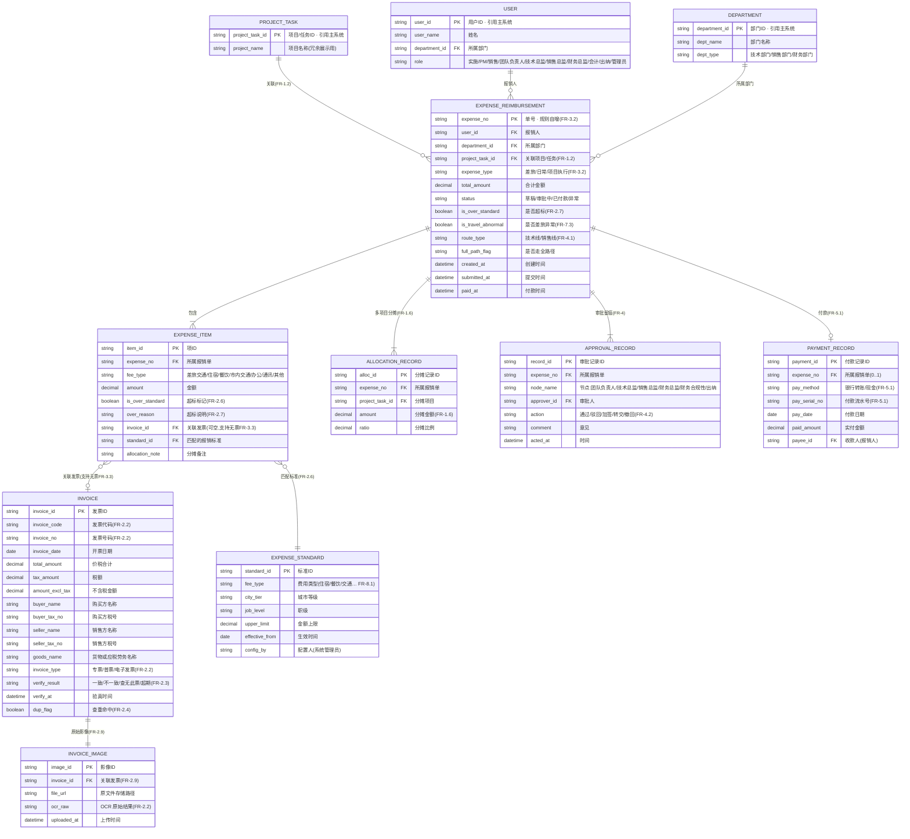

# 报销管理子系统 · 系统 ER 图

> 来源：《报销管理子系统需求规格说明书 V1.1》· 第五章 数据模型（关键实体与字段）。
> 外系统实体（项目/任务、用户、部门）以"参考实体"形式给出，仅保留报销侧的主键与外键引用关系。

## 实体关系总览（Mermaid）

> 注：审批留痕由主系统基础平台审计能力统一提供（参见 FR-4.7 已移除），`APPROVAL_RECORD` 实体保留为业务视图，实际存储可对接基础平台。

## 关键设计说明

### 1. 主实体
- **EXPENSE_REIMBURSEMENT** 是聚合根，承载一张报销单的完整生命周期。
- `route_type`（技术线 / 销售线）+ `full_path_flag`（是否走全路径）共同驱动 FR-4.1 条件路由。
- `is_over_standard` / `is_travel_abnormal` 由费用项匹配（FR-2.6）与差旅比对（FR-7.2）汇总得到。

### 2. 关系约束
| 关系 | 基数 | 业务约束 |
| --- | --- | --- |
| 报销单 → 费用项 | 1 : N | 至少 1 条（保存草稿时可暂为空） |
| 报销单 → 分摊记录 | 1 : N | 各分摊金额合计 = 报销单合计（BR-5） |
| 报销单 → 审批记录 | 1 : N | 留痕所有审批动作（FR-4.2） |
| 报销单 → 付款记录 | 1 : 0..1 | 付款前为空，付款后落 1 条（FR-5.1） |
| 费用项 → 发票 | N : 0..1 | 支持无票/预付（FR-3.3，须说明） |
| 发票 → 发票影像 | 1 : 1 | 影像与结构化数据一一绑定（FR-2.9） |
| 费用项 → 报销标准 | N : 1 | 按费用类型 + 城市等级 + 职级匹配（FR-2.6/8.1） |

### 3. 跨系统引用
- `PROJECT_TASK / USER / DEPARTMENT` 三个实体由主系统统一管理，本子系统**只读引用**主键，不在本子系统内维护其主数据。
- 字段级访问控制：报销人仅可见本人单据；项目经理/团队负责人可见所辖项目；财务可见金额与发票明细，不可见技术细节（见需求文档第 2 章 字段级访问控制）。

### 4. 归档与不可变
- 报销单结案（已付款）后，连同发票影像、审批记录、付款记录由 **FR-6.1 自动归集** 至项目归档包，转为只读（FR-6.3），不再参与日常 CRUD。
